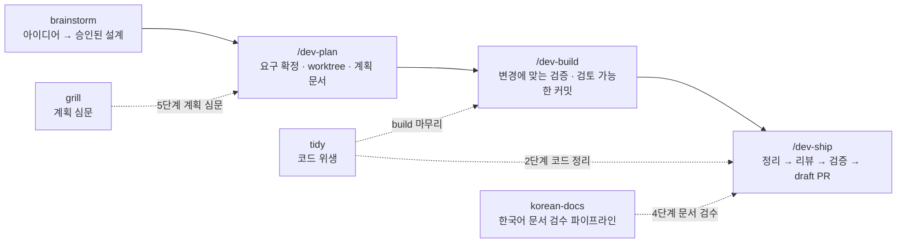

# ruccess/skills

[](LICENSE)
[](https://docs.anthropic.com/en/docs/claude-code)
[](#codex)

개발 작업을 계획에서 draft PR까지 끌고 가는 에이전트 스킬 스위트다. 산출물 품질 스킬을 함께 담는다.
Agent skills that carry a dev task from plan to draft PR — with gates, not vibes. Writing-quality skills included.



## 왜 만들었나

에이전트에게 "PR 올려줘"라고 하면 곧장 `git push`와 PR 생성으로 직행한다. 하지만 실제 측정에서 보면 에이전트는 정리 단계를 건너뛰고, 문서 검수를 빼먹으며, draft가 아닌 일반 PR을 만든다. 구현 완료와 출하 가능은 다르다. 이 스위트는 그 사이를 메운다.

superpowers나 mattpocock 같은 범용 스위트와의 차별점은 세 가지다 — 게이트가 있는 고정 라이프사이클, 한국어 산출물 품질, 실측 기반 토큰 경제. 프로젝트의 기존 규칙·스크립트·에이전트를 재사용하는 얇은 워크플로우 접착제를 지향한다.

## 워크플로우 스킬

### `brainstorm` — 아이디어를 승인된 설계로

요구사항이나 설계 선택이 미정일 때 구현 전에 그 선택을 확정한다.
이미 승인된 설계나 중요한 모호함이 없는 구체적 변경에는 재승인을 요구하지 않는다.
질문은 한 번에 하나씩 하고, 접근 2~3개의 장단점을 비교한 뒤 승인된 설계를 짧은 문서로 남긴다.
[obra/superpowers](https://github.com/obra/superpowers)의 brainstorming을 증류한 경량판이다.

### `/dev-plan` — 작업 시작

코드보다 계획이 먼저다. 요구를 확정하고 작업 공간을 격리한 뒤 계획 문서를 남긴다. 계획 문서에는 요구사항 추적표(원문 항목별 행 + 원문 판 시각)와 미결 질문 절이 필수다 — 정본은 언제나 원문 문서이고 추적표는 시점이 박힌 사본이다. 프로젝트에 자체 작업 시작 스크립트가 있으면 그것을 따르고, 없으면 git worktree로 브랜치를 격리한다. 아이디어가 아직 흐릿하면 brainstorm부터 시작하고, 계획 확정 전에는 grill로 심문한다.

### `grill` — 계획 심문

결정 트리의 모든 가지를 질문으로 하나씩 해소한다 — 각 질문에 추천 답을 붙이고, 코드가 답할 수 있는 건 묻지 않고 읽는다. 소규모 저위험 변경이면 위험이 실제로 걸린 가지 1~2개만 다룬다. 용어는 프로젝트 용어집(CONTEXT.md)과 대조하고, 해소된 결정은 바로 문서에 남긴다. ADR은 되돌리기 어렵고·맥락 없이 놀랍고·진짜 트레이드오프일 때만 작성한다. 세션이 만진 한국어 문서는 마지막에 korean-docs 파이프라인으로 다듬는다. grill-with-docs를 증류한 경량판이다.

### `/dev-build` — 구현

계획 문서가 없으면 구현하지 않는다.
테스트할 수 있는 동작 변경에는 TDD를 적용하고, 문서나 설정은 변경 내용과 사용처에 맞는 검사로 검증한다.
커밋은 저장소 규칙과 사용자 지시에 따라 하나의 검토 가능한 변경으로 묶는다.
계획에서 벗어나면 계획부터 갱신하고, 마무리는 tidy로 정리한 뒤 영향받는 검증을 다시 실행한다.

### `/dev-ship` — 마무리와 draft PR

사용자가 PR을 요청했거나 합의한 작업 범위에 PR이 포함된 경우에 실행한다.
평가·리뷰·푸시만 요청한 작업에는 적용하지 않는다.
기본 경로는 여덟 단계를 순서대로 확인하며, 수정 후에는 입력이 바뀐 단계만 다시 검사한다.

빠른 경로는 1~2개 파일·변경 100줄 미만이고 마이그레이션·스키마·공개 API·인증·권한·비밀정보·의존성·배포·CI·런타임 설정을 건드리지 않을 때만 적용한다.
영향이 불명확하면 기본 경로를 따른다.
빠른 경로도 1(변경 파악)·2(정리)·5(검증)·7(거버넌스)·8(Draft PR)을 확인하며, 요구사항 추적표가 있으면 6(스펙 대조)도 확인한다.
저장소가 요구하는 리뷰와 검증은 빠른 경로에서도 생략하지 않는다.

| 단계 | 내용 | 게이트 |
|---|---|---|
| 1 | 변경 파악 | 기준 브랜치 대비 커밋 차이와 staged·unstaged·untracked 변경 확인 |
| 2 | 코드 정리 | tidy — 동작 보존 정리만. 직전 tidy 이후 변경 없으면 스킵 |
| 3 | 리뷰 | CRITICAL·HIGH 수정, MEDIUM 이하 보고. 수정했으면 tidy 재적용 |
| 4 | 문서 검수 | 한국어 문서 중 grill에서 검수 안 된 것만 korean-docs 파이프라인 |
| 5 | 검증 | 테스트·린트 실패 시 여기서 정지 |
| 6 | 스펙 대조 | 계획의 요구사항 추적표 전 행을 충족/미충족/범위외로 판정, 원문 판 시각이 움직였으면 변경분 재판정 — 미충족 시 정지 |
| 7 | 거버넌스 | 체크리스트·리뷰 트리거·ADR 요건 — 미충족 시 정지, 검증과 같은 강도 |
| 8 | draft PR | 생성 직전 요약 보고 후 `--draft`로 생성 — draft만이 기본 |

## 산출물 품질 스킬

AI가 쓴 글은 티가 난다 — 번역투, 이중 피동, 상투어. 두 스킬이 채팅과 문서를 각각 담당한다. 플러그인에는 한글 감지 리마인드 hook이 동봉된다 — Write/Edit에서 한국어 텍스트를 감지하면 두 스킬의 점검 기준을 상기시킨다(세션당 10분 디바운스).

### `korean-chat` — 응답·메시지

답이나 바로 실행할 행동을 첫 줄에 두고, 절차는 번호로 나누며 병렬 사실은 불릿으로 쓴다.
명사형 종결(`~음/~함/~임/~됨`)을 기본으로 하되, 사용자가 말투를 명시하면 그 요청을 따른다.
[JuliusBrussee/caveman](https://github.com/JuliusBrussee/caveman) 원칙을 증류해 인사·빈 헤징·재진술·예고성 설명을 제거하고 짧게 쓰되, 의미 있는 불확실성과 기술 용어·코드·정확한 오류·부정·수치·단위·조사는 보존한다.
[ayghri/i-have-adhd](https://github.com/ayghri/i-have-adhd)의 원칙을 증류해 여러 단계 작업의 확인된 상태를 짧게 표시하고, 사용자 행동이 필요할 때 다음 행동 하나를 제시한다.
목록은 한 묶음에 다섯 항목 이하를 권장하되 요청한 정보와 중요한 근거는 생략하지 않는다.
시간 추정에는 근거와 가정을 밝히며, 충분한 설명이 필요한 요청과 보안 경고·되돌릴 수 없는 확인·순서 의존 절차에서는 압축을 완화한다.

### `korean-docs` — 문서 산출·검수

문서는 사람이 읽기 쉬운 완결 산문으로 쓴다.
한 문단에는 주장 하나만 두고, 산문 문장은 한 문장씩 소스 줄에 둔다.
빈 줄은 의미가 바뀔 때만 넣는다.
정확한 수치·경로·명령어는 보존하면서 자연스럽고 정확한 한국어로 다듬는다.

화살표는 3~4노드 이하의 짧고 선형적인 관계를 더 빨리 읽게 할 때만 선택적으로 쓴다.
분기와 예외는 목록·표·Mermaid로 표현한다.

Pass 1은 별도 검토 맥락에서 독자 관점으로 문서 구조와 훑어 읽기 쉬운지를 검수한다.
Pass 2에서는 자연스러운 한국어를 먼저 점검한 뒤 전체 패턴 체크리스트를 안전망으로 적용한다.
[DaleSeo/korean-skills](https://github.com/DaleSeo/korean-skills) 플러그인의 humanizer → grammar-checker는 Pass 2만 대체하며 Pass 1은 유지한다.

변경률이 30%를 넘으면 적용 대신 보고한다.
`/dev-ship` 4단계가 이 스킬을 호출한다.

### `tidy` — 코드 위생

이번 작업의 변경분에서 근거가 확인된 최소 정리만 수행한다.
호출 검색 결과가 없거나 함수가 길다는 이유만으로 삭제·분리하지 않고, 동적 사용처와 외부 계약을 확인한다.
의도적인 테스트 제외·운영 로그는 보존하며, 코드와 주석의 의도가 불명확하면 수정 대신 불일치를 보고한다.
정리 후에는 관련 검사와 함께 공개 인터페이스·오류·부작용·실행 순서의 변화를 확인하고, 검증하지 못한 범위를 밝힌다.
기능 변경과 정리 커밋은 분리하며, `/dev-build` 마무리와 `/dev-ship` 2단계에서 사용한다.

## 토큰 경제

### `context-thrift` — 컨텍스트를 돈처럼 쓴다

비용 최적화 요청, 넓은 저장소 탐색, 큰 도구 출력, 오래 걸리는 검사에 적용한다.
독립 호출을 묶고 출력을 줄이며, 위임 비용이 타당할 때만 서브에이전트를 사용한다.
도구 호출 수와 모델 왕복 횟수는 다르며, 총비용은 입력·출력·캐시·모델 요금·실행 환경에 따라 달라진다.

과거 저자 세션에서는 854개 메시지의 855개 도구 호출에서 캐시 읽기 약 4억 토큰이 기록됐다.
이는 특정 작업의 관측값이며, 세 호출을 묶는다고 총비용이 항상 ⅔ 줄어드는 것은 아니다.
자기 세션은 `bunx ccusage` 등의 사용량 기록으로 품질·비용·시간을 함께 비교한다.

## 설계 원칙

- **저장소 규칙 우선** — 커밋 형식·브랜치·PR·검증 명령은 대상 저장소의 지침이 결정한다. 스킬은 순서와 게이트만 정의한다
- **얇은 오케스트레이션** — 프로젝트에 이미 있는 시작 스크립트·실행 루프·리뷰 에이전트를 재사용한다. 스킬이 바퀴를 다시 만들지 않는다
- **draft가 기본** — PR은 항상 draft로 시작한다. 검증 실패 상태의 PR은 존재하지 않는다

## 설치

### Claude Code

```bash
claude plugin marketplace add ruccess/skills
claude plugin install ruccess@ruccess
```

korean-docs의 검수는 스킬 자체 체크리스트만으로 동작한다. 더 정밀한 검수를 원하면 [DaleSeo/korean-skills](https://github.com/DaleSeo/korean-skills) 플러그인을 얹는다 — 선택 사항이다. ruccess 마켓플레이스가 해당 저장소를 함께 참조하므로 별도 마켓플레이스 등록 없이 바로 설치한다.

```bash
claude plugin install korean-skills@ruccess
```

### Codex

스킬 본문은 런타임 중립 markdown이라 그대로 프롬프트로 사용한다. korean-docs의 검수 체크리스트도 본문에 들어 있어 외부 저장소를 클론하지 않고 아홉 스킬 전부 그대로 쓴다.

```bash
git clone https://github.com/ruccess/skills ~/ruccess-skills
for s in brainstorm dev-plan grill dev-build dev-ship korean-chat korean-docs tidy context-thrift; do
  ln -sf ~/ruccess-skills/skills/$s/SKILL.md ~/.codex/prompts/$s.md
done
```

## 로드맵

- **v0.5 (완료)** — 안정화: 스킬별 테스트 시나리오 문서화(`docs/test-scenarios.md`), frontmatter 검증 CI(`scripts/validate.mjs`), CONTRIBUTING.md, 한글 감지 리마인드 hook 동봉
- **v1.0** — 팀 공유용 안정판. using-ruccess 라우터 스킬(상시 주입 없이 목록만으로 라우팅)은 그 후 검토

## License

[MIT](LICENSE)
