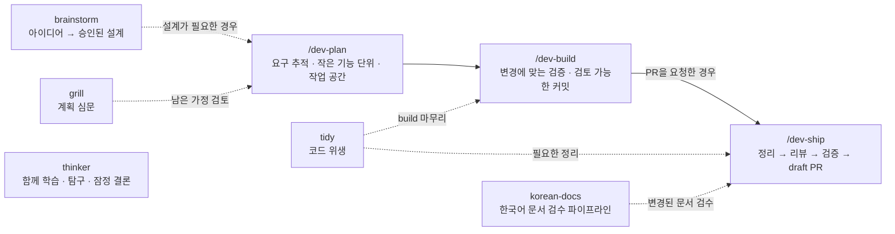

# ruccess/skills

[](LICENSE)
[](https://docs.anthropic.com/en/docs/claude-code)
[](#codex)

개발 작업의 계획·구현·Draft PR을 돕는 에이전트 스킬 스위트다.
함께 배우고 고민하는 동료 스킬과 한국어 산출물 품질 스킬을 함께 담는다.



## 왜 만들었나

코드가 완성되어도 요구사항이 빠졌거나 검증 근거가 부족할 수 있다.
스킬은 작업 범위와 실제 증거를 연결해 이런 누락을 확인한다.
이미 합의된 결정을 다시 묻거나 같은 변경을 반복 검사하는 절차도 줄인다.

기존 스킬 이름을 유지하면서 [맷 포콕 스킬](https://github.com/mattpocock/skills)의 기능 단위 작업 분해, 공개 동작 테스트, 두 관점의 리뷰, 전후 증거 제시 방식을 선별해 적용한다.
프로젝트의 기존 규칙·스크립트·에이전트를 우선하며, 판단을 돕는 구체적인 기준과 예시를 남긴다.

## 워크플로우 스킬

### `brainstorm` — 아이디어를 승인된 설계로

요구사항이나 설계 선택이 미정일 때 구현 전에 그 선택을 확정한다.
이미 승인된 설계나 중요한 모호함이 없는 구체적 변경에는 재승인을 요구하지 않는다.
질문은 한 번에 하나씩 하고, 접근 2~3개의 장단점을 비교한 뒤 승인된 설계를 짧은 문서로 남긴다.
[obra/superpowers](https://github.com/obra/superpowers)의 brainstorming을 증류한 경량판이다.

### `/dev-plan` — 작업 시작

합의된 요구를 사용자가 확인할 수 있는 작은 기능 단위로 나누고, 각 단계의 검증 증거와 실제 선행 조건을 적는다.
예를 들어 DB·API·화면을 각각 끝내는 계획보다 특정 동작을 저장부터 화면 확인까지 검증하는 단위를 우선한다.
원문 항목별 추적표와 원문 판 시각을 남기며, 보류 항목과 뒤에 추가된 요구도 누락하지 않는다.
프로젝트의 작업 시작 스크립트와 문서 규칙을 따르고, 명확한 소규모 작업은 대화나 이슈에 적힌 합의로 진행할 수 있다.
남은 설계 위험이 있을 때만 `grill`을 적용한다.

### `grill` — 계획 심문

구체적인 계획에서 정확성·범위·되돌리기에 영향을 주는 남은 가정을 검토한다.
코드와 문서로 답할 내용은 먼저 조사하고, 이미 합의된 내용은 새로운 근거가 있을 때만 다시 연다.
프로젝트 용어와 실제 실패 상황을 사용해 질문하고, 결정은 필요한 문서에 남긴다.
사용자가 개념을 함께 배우거나 열린 질문을 탐구하려는 경우에는 `thinker`가 맞는다.

### `thinker` — 함께 배우고 고민하는 동료

기술 설계뿐 아니라 업무와 학습에서 아직 정리되지 않은 생각을 함께 탐구한다.
설명·예시·가설·반례를 제시하고, 관찰한 사실과 추정을 구분하면서 사용자의 이해를 발전시킨다.
매번 선택을 요구하지 않으며, 사용자가 원하면 결론을 잠정적으로 남기고 다음에 확인할 근거를 찾는다.
추천이 필요할 때는 이유와 한계를 설명하고, 이미 합의된 실행을 요청하면 토론을 계속 강요하지 않는다.

### `/dev-build` — 구현

대화·이슈·계획에 범위와 기대 동작이 합의되어 있으면 진행하며, 계획 파일의 존재만으로 구현을 막지 않는다.
테스트는 공개 인터페이스에서 관찰할 수 있는 동작을 확인하고, 기대값은 명세나 독립적으로 계산한 사례에서 가져온다.
실패하는 테스트 하나를 확인한 뒤 최소 구현으로 통과시키는 단위를 반복한다.
문서나 설정은 변경 내용과 사용처에 맞는 검사로 검증한다.
커밋은 저장소 규칙과 사용자 지시에 따라 하나의 검토 가능한 변경으로 묶는다.
계획에서 벗어나면 계획부터 갱신하고, 마무리는 tidy로 정리한 뒤 영향받는 검증을 다시 실행한다.

### `/dev-ship` — 마무리와 draft PR

사용자가 PR을 요청했거나 합의한 작업 범위에 PR이 포함된 경우에 실행한다.
평가·리뷰·푸시만 요청한 작업에는 적용하지 않는다.
변경의 실제 동작과 영향에 맞춰 검토하고, 입력이 그대로인 정리·리뷰·검증 결과는 재사용한다.
작은 변경도 인증·스키마·외부 계약에 영향을 줄 수 있으므로 파일 수나 줄 수만으로 검토를 생략하지 않는다.

리뷰는 저장소 규칙 준수와 원문 요구사항 충족을 구분한다.
계획 파일이 없어도 원래 합의를 대조하며, 요구사항 추적표가 있으면 원문 변경과 모든 행의 구현 근거를 확인한다.
근거 없는 범위 제외, 실패한 필수 검증, 미충족 거버넌스는 PR 생성을 막는다.
아직 검수하지 않은 한국어 문서는 변경 규모와 무관하게 검수한다.

PR에는 문제와 바뀐 동작, 실제 전후 증거, 영향과 되돌리기 정보를 변경 규모에 맞춰 적는다.
완료 보고는 Draft URL이나 구체적인 장애 요인을 먼저 보여주고 검증과 남은 문제를 설명한다.
단계별 빈 상태표는 출력하지 않으며, 로컬 검증·CI·배포·실제 실행 결과를 구분한다.

## 산출물 품질 스킬

AI가 쓴 글은 티가 난다 — 번역투, 이중 피동, 상투어. 두 스킬이 채팅과 문서를 각각 담당한다. 플러그인에는 한글 감지 리마인드 hook이 동봉된다 — Write/Edit에서 한국어 텍스트를 감지하면 두 스킬의 점검 기준을 상기시킨다(세션당 10분 디바운스).

### `korean-chat` — 응답·메시지

답이나 바로 실행할 행동을 첫 줄에 두고, 절차는 번호로 나누며 병렬 사실은 불릿으로 쓴다.
일반 대화는 존댓말로 쓰며, 명사형 종결(`~음/~함/~임/~됨`)은 사용자가 요청하거나 해당 보고·메모의 형식으로 정해진 경우에 쓴다.
의미와 근거, 독자에게 필요한 설명, 자연스러운 말투, 간결함 순으로 점검한다.
짧은 질문이라도 낯선 개념에는 쉬운 설명과 구체적인 예시를 제공한다.
[JuliusBrussee/caveman](https://github.com/JuliusBrussee/caveman) 원칙을 증류해 인사·빈 헤징·재진술·예고성 설명을 제거하고 짧게 쓰되, 의미 있는 불확실성과 기술 용어·코드·정확한 오류·부정·수치·단위·조사는 보존한다.
[ayghri/i-have-adhd](https://github.com/ayghri/i-have-adhd)의 원칙을 증류해 여러 단계 작업의 확인된 상태를 짧게 표시하고, 사용자 행동이 필요할 때 다음 행동 하나를 제시한다.
목록은 한 묶음에 다섯 항목 이하를 권장하되 요청한 정보와 중요한 근거는 생략하지 않는다.
시간 추정에는 근거와 가정을 밝히며, 충분한 설명이 필요한 요청과 보안 경고·되돌릴 수 없는 확인·순서 의존 절차에서는 압축을 완화한다.

### `korean-docs` — 문서 산출·검수

문서는 사람이 읽기 쉬운 완결 산문으로 쓴다.
독자의 배경지식에 맞춰 용어와 인과관계를 설명하며, 문체를 다듬다가 조건이나 주장 강도를 바꾸지 않는다.
한 문단에는 주장 하나만 두고, 산문 문장은 한 문장씩 소스 줄에 둔다.
빈 줄은 의미가 바뀔 때만 넣는다.
정확한 수치·경로·명령어는 보존하면서 자연스럽고 정확한 한국어로 다듬는다.

화살표는 3~4노드 이하의 짧고 선형적인 관계를 더 빨리 읽게 할 때만 선택적으로 쓴다.
분기와 예외는 목록·표·Mermaid로 표현한다.

Pass 1은 별도 검토 맥락에서 독자 관점으로 문서 구조와 훑어 읽기 쉬운지를 검수한다.
Pass 2에서는 자연스러운 한국어를 먼저 점검한 뒤 전체 패턴 체크리스트를 안전망으로 적용한다.
[DaleSeo/korean-skills](https://github.com/DaleSeo/korean-skills) 플러그인의 humanizer → grammar-checker는 Pass 2만 대체하며 Pass 1은 유지한다.

기존 문서의 문체 교정은 원본 소스 줄 기준 변경률이 30%를 넘으면 비율을 보고하고, 해당 범위를 승인받지 않았다면 적용을 멈춘다.
이미 승인된 재작성 범위와 새 문서 작성은 이 중단 조건에 해당하지 않는다.
`/dev-ship`에서 변경된 문서를 검수하며, 현재 변경분에 유효한 검수 결과는 재사용한다.

### `tidy` — 코드 위생

이번 작업의 변경분에서 근거가 확인된 최소 정리만 수행한다.
호출 검색 결과가 없거나 함수가 길다는 이유만으로 삭제·분리하지 않고, 동적 사용처와 외부 계약을 확인한다.
의도적인 테스트 제외·운영 로그는 보존하며, 코드와 주석의 의도가 불명확하면 수정 대신 불일치를 보고한다.
정리 후에는 관련 검사와 함께 공개 인터페이스·오류·부작용·실행 순서의 변화를 확인하고, 검증하지 못한 범위를 밝힌다.
기능 변경과 정리 커밋은 분리하며, `/dev-build` 마무리와 `/dev-ship`의 필요한 정리에 사용한다.

## 토큰 경제

### `context-thrift` — 컨텍스트를 돈처럼 쓴다

비용 최적화 요청, 넓은 저장소 탐색, 큰 도구 출력, 오래 걸리는 검사에 적용한다.
독립 호출을 묶고 출력을 줄이며, 위임 비용이 타당할 때만 서브에이전트를 사용한다.
도구 호출 수와 모델 왕복 횟수는 다르며, 총비용은 입력·출력·캐시·모델 요금·실행 환경에 따라 달라진다.

과거 저자 세션에서는 854개 메시지의 855개 도구 호출에서 캐시 읽기 약 4억 토큰이 기록됐다.
이는 특정 작업의 관측값이며, 세 호출을 묶는다고 총비용이 항상 ⅔ 줄어드는 것은 아니다.
자기 세션은 `bunx ccusage` 등의 사용량 기록으로 품질·비용·시간을 함께 비교한다.

## 설계 원칙

- **저장소 규칙 우선** — 커밋 형식·브랜치·PR·검증 명령은 대상 저장소의 지침이 결정한다. 스킬은 작업 범위와 검증 근거를 연결한다
- **얇은 오케스트레이션** — 프로젝트에 이미 있는 시작 스크립트·실행 루프·리뷰 에이전트를 재사용한다. 스킬이 바퀴를 다시 만들지 않는다
- **draft가 기본** — PR은 항상 draft로 시작한다. 검증 실패 상태의 PR은 존재하지 않는다

## 설치

### Claude Code

```bash
claude plugin marketplace add ruccess/skills
claude plugin install ruccess@ruccess
```

korean-docs의 검수는 스킬 자체 체크리스트만으로 동작한다. 더 정밀한 검수를 원하면 [DaleSeo/korean-skills](https://github.com/DaleSeo/korean-skills) 플러그인을 얹는다 — 선택 사항이다. ruccess 마켓플레이스가 해당 저장소를 함께 참조하므로 별도 마켓플레이스 등록 없이 바로 설치한다.

```bash
claude plugin install korean-skills@ruccess
```

### Codex

스킬 폴더를 `~/.agents/skills`에 연결하면 Codex가 `SKILL.md`를 발견한다.
폴더 링크는 저장소의 현재 내용을 따르므로 복사본을 따로 갱신할 필요가 없다.
저장소를 이동하거나 브랜치를 바꾸면 설치 내용에도 영향을 준다.
아래 명령은 같은 이름의 설치 폴더나 링크가 없는 환경의 최초 설치용이다.
모든 대상을 먼저 검사하고 충돌이 하나라도 있으면 링크 생성 전에 중단한다.
기존 설치본의 교체와 복구는 [한국어 스킬 동기화 기록](evals/findings-2026-10-15.md#설치-동기화-방식)을 참고한다.
설치 경로와 폴더 링크 지원은 [공식 스킬 안내](https://learn.chatgpt.com/docs/build-skills)를 따른다.

```bash
git clone https://github.com/ruccess/skills ~/ruccess-skills
mkdir -p ~/.agents/skills
for s in brainstorm dev-plan grill thinker dev-build dev-ship korean-chat korean-docs tidy context-thrift; do
  if [ -e ~/.agents/skills/$s ] || [ -L ~/.agents/skills/$s ]; then
    printf '기존 설치본을 먼저 백업하세요: %s\n' ~/.agents/skills/$s >&2
    exit 1
  fi
done
for s in brainstorm dev-plan grill thinker dev-build dev-ship korean-chat korean-docs tidy context-thrift; do
  ln -s ~/ruccess-skills/skills/$s ~/.agents/skills/$s
done
```

기존 링크가 같은 checkout을 가리키면 `git -C ~/ruccess-skills pull --ff-only`로 스킬 내용도 함께 갱신된다.
`readlink ~/.agents/skills/thinker`처럼 대상을 확인할 수 있다.
기존 경로가 일반 폴더이거나 다른 checkout을 가리키면 내용을 비교한 뒤 필요한 링크만 직접 변경한다.

## 로드맵

- **v0.5 (완료)** — 안정화: 스킬별 테스트 시나리오 문서화(`docs/test-scenarios.md`), frontmatter 검증 CI(`scripts/validate.mjs`), CONTRIBUTING.md, 한글 감지 리마인드 hook 동봉
- **v1.0** — 팀 공유용 안정판. 기존 개발 스킬의 판단 기준과 공동 탐구 역할을 행동 사례로 검증한다

## License

[MIT](LICENSE)

외부 스킬의 출처와 고지는 [THIRD_PARTY_NOTICES.md](THIRD_PARTY_NOTICES.md)에 기록한다.
